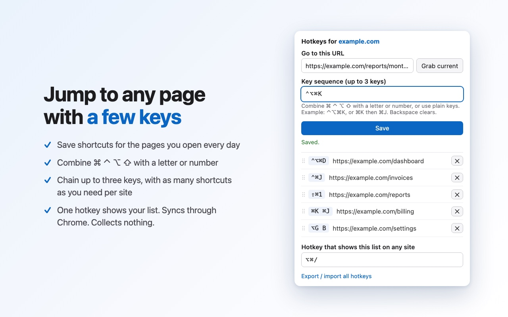
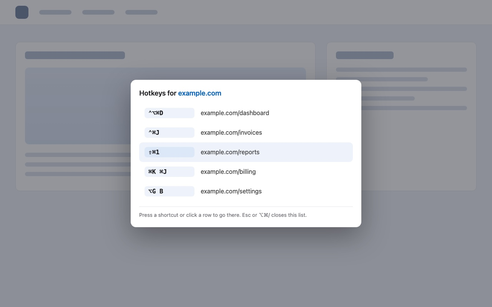

# Site Hotkeys

A Chrome extension that jumps to the pages you use most on a website with a short keyboard shortcut.

Save a page, press the keys you want, and from then on typing that sequence on that site takes you straight there. One hotkey shows a pop-up list of your shortcuts for the site you are on.




## Features
- Combine Command, Control, Option and Shift with a letter or number, or chain up to three keys. Examples: `⌃⌥⌘K`, or `⌘K` then `⌘J`.
- Per-site shortcuts, as many as you need on each site.
- A pop-up reference of the site's shortcuts, opened with one hotkey you choose (default `⌥⌘/`). Press a shortcut or click a row to go there. Esc closes it.
- Click a saved shortcut to edit it, or drag to reorder.
- Export and import all your shortcuts as a file.
- Syncs through your Chrome profile (`chrome.storage.sync`).
- Plain-key shortcuts stay out of the way while you type in a text box.
- Collects nothing, sends nothing. See the [privacy policy](https://basilbabaa.com/site-hotkeys/privacy/).

## Install
- **Chrome Web Store:** listing coming soon. More at https://basilbabaa.com/site-hotkeys/
- **From source:** open `chrome://extensions`, turn on Developer mode, click Load unpacked, and pick this folder. After editing, click Reload on the extension, then reload any tab you want to use it on.

## Use it
1. Open a website and click the Site Hotkeys icon.
2. Click "Grab current" to fill in the page's address, or type one.
3. Click the key sequence box and press your keys (up to three).
4. Click Save. Click a saved shortcut any time to change it.

## How it works
- `content.js` runs on http(s) pages. It loads the shortcuts for the page's domain, matches key presses against them, and draws the list pop-up (a closed shadow-DOM overlay).
- `popup.html` / `popup.js`: add, edit, delete and reorder shortcuts for the current site; set the list hotkey.
- `options.html` / `options.js`: export and import.
- `storage.js`: helpers. Data lives in `chrome.storage.sync`, one item per domain (`sc:example.com`, a list of `{ keys, url }`) because Chrome caps a single item at about 8 KB. The list hotkey is `cfg:showHotkey`. `background.js` migrates the older single-item layout.
- A key token is modifiers plus the physical key, for example `alt+g` or `ctrl+alt+meta+k`. A sequence is tokens separated by spaces.
- Permissions: `storage`, `activeTab`, and a content script on http(s) pages.

The manifest `key` gives the unpacked extension a fixed ID so storage sync matches across machines. The build strips it, because the Chrome Web Store assigns its own.

## Develop
```bash
node test/test.js     # key combos, sequences, list pop-up, storage and migration
./build.sh            # writes dist/site-hotkeys-<version>.zip for the Chrome Web Store
```
Store listing text, screenshots and promo-tile sources are in `store/`. `store/listing.md` is the click-by-click submission checklist.

## License
MIT. See [LICENSE](LICENSE).
